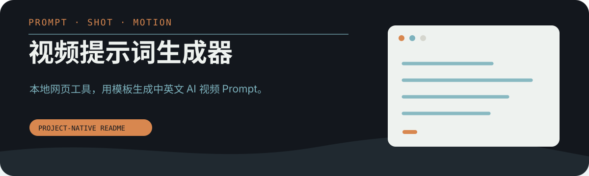
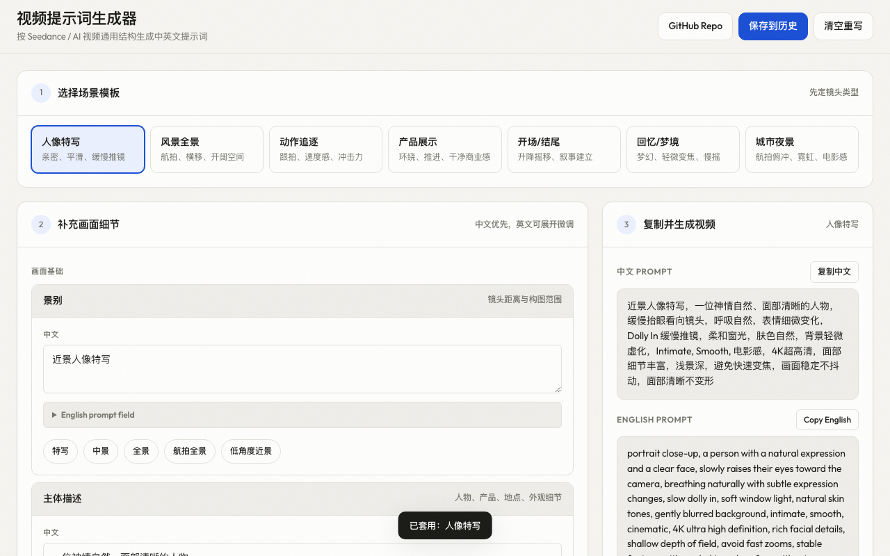

<p align="right"><a href="README.md">中文</a></p>

<p align="center">
  
</p>

<p align="center">
  <a href="https://holynova.github.io/video_prompt_generator/">▶ Use Online</a>
  ·
  <a href="https://github.com/holynova/video_prompt_generator">GitHub Repository</a>
</p>

Video Prompt Generator is a local web tool for AI video prompts: pick a scene template, fill in 8 shot fields, and get a bilingual (Chinese + English) prompt ready to paste into Jimeng, Kling, Sora, and other video models. No English jargon to memorize, no sentences to compose from scratch.

## Screenshot

<p align="center">
  
</p>

## How It Works

1. **Pick a scene template**: 7 templates — tap one and a full set of fields is filled in for you — 人像特写 (Portrait Close-Up), 风景全景 (Landscape Panorama), 动作追逐 (Action Chase), 产品展示 (Product Showcase), 开场/结尾 (Opening/Ending), 回忆/梦境 (Memory/Dream), 城市夜景 (Night City).
2. **Add shot details**: 8 fields in 4 groups — 画面基础 (Shot Basics: shot type, subject description), 动作与运镜 (Action & Camera: action, camera moves), 氛围与风格 (Mood & Style: lighting and mood, style tags), 输出约束 (Output Constraints: quality tags, stability constraints). Every field has a Chinese input with an expandable English field for fine-tuning, plus 5 bilingual quick-pick chips (40 in total).
3. **Copy and generate**: the Chinese and English prompts are generated live on the right — copy the Chinese, English, or bilingual version in one click. Below are quick links to 10 popular video models (即梦 Jimeng, Dreamina, Kling, Runway, Luma, Pika, Hailuo, Vidu, Sora, Flow).

## Features

- **Bilingual**: Chinese first, with English expandable for fine-tuning; the Chinese and English prompts are independent and copyable separately.
- **History & favorites**: save generated prompts to history (localStorage, in your own browser); favorite a combination to find it quickly in the 「收藏」 ("Favorites") tab; history can be cleared in one click.
- **Mobile friendly**: a quick-action bar at the bottom (copy bilingual / copy Chinese / favorite) keeps small screens easy to use.
- **Fully local**: no network, no uploads — prompts stay in your browser.

## Run Locally

Zero build, a single-file app:

```bash
open index.html
# Or: npm start (python3 -m http.server 5173)
```

## Tech

- A single `index.html` (styles + logic all in-page), zero build, zero dependencies.
- Templates and fields are fully data-driven: `templates` (7 scenes) and `fields` (8 fields × 5 quick-pick chips) are JS arrays in the page — change a template by changing the data.
- History and favorites persist in localStorage (key: `video-prompt-generator-history-v1`).

```
index.html          Entry: template selection, field editing, bilingual output, model links, history/favorites
package.json        start (local static server) and test (file-existence check)
assets/             Screenshots (kept)
screenshot.png      Main interface screenshot (kept)
```
