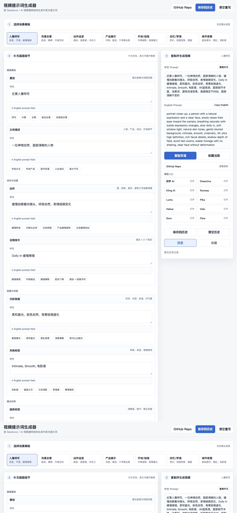

# 视频提示词生成器

本地网页工具，用模板生成中英文 AI 视频 Prompt。



[在线生成提示词](https://holynova.github.io/video_prompt_generator/) · [源码](https://github.com/holynova/video_prompt_generator)

## 使用流程

选择模板，填写画面描述并调整选项，生成后复制中英文 Prompt，再粘贴到视频生成工具中。本站生成提示词文本，不直接生成视频。

## 本地运行

在仓库根目录执行：

```bash
python3 -m http.server 5173
```

打开 [localhost:5173](http://localhost:5173)。页面、样式与生成逻辑均在 [index.html](index.html)，无需构建或安装前端依赖。
