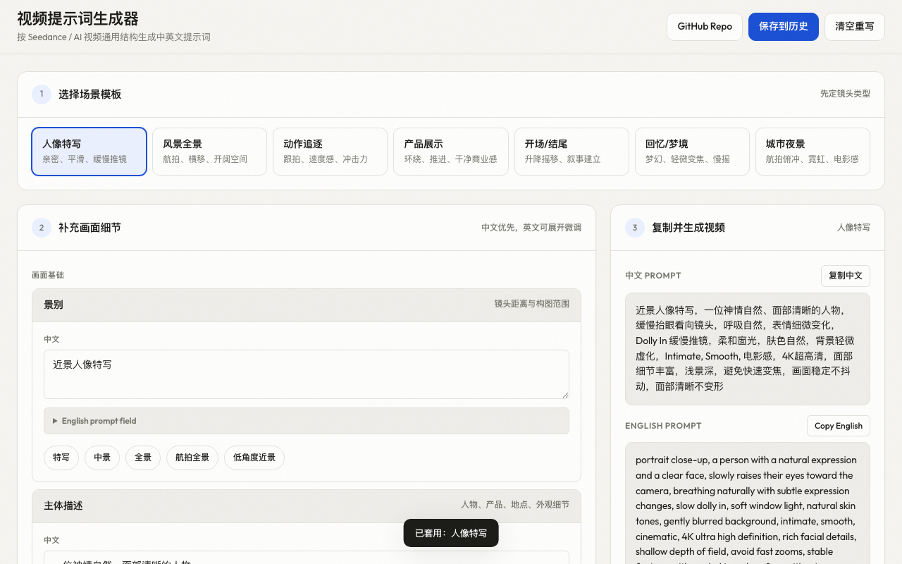

<p align="right"><a href="README.en.md">English</a></p>

<p align="center">
  
</p>

<p align="center">
  <a href="https://holynova.github.io/video_prompt_generator/">▶ 在线使用</a>
  ·
  <a href="https://github.com/holynova/video_prompt_generator">GitHub 仓库</a>
</p>

视频提示词生成器是一个本地网页工具：按 Seedance / AI 视频通用结构，先选场景模板，再填 8 个画面字段，一键生成中英双语提示词，复制后粘贴到即梦、Kling、Sora 等视频模型就能用。不用背英文术语，不用从零拼句子。

## 截图

<p align="center">
  
</p>

## 怎么用

1. **选场景模板**：7 个模板，点一个就填好一整套字段——人像特写、风景全景、动作追逐、产品展示、开场/结尾、回忆/梦境、城市夜景。
2. **补充画面细节**：8 个字段分 4 组——画面基础（景别、主体描述）、动作与运镜（动作、运镜指令）、氛围与风格（光影氛围、风格标签）、输出约束（画质标签、稳定性约束）。每个字段都有中文输入框、英文可展开微调，另有 5 个中英对照快捷词点选（共 40 个）。
3. **复制并生成视频**：右侧实时生成中文与英文两份提示词，一键复制中文、英文或双语；下方有 10 个常用视频模型的入口链接（即梦、Dreamina、Kling、Runway、Luma、Pika、Hailuo、Vidu、Sora、Flow）。

## 功能

- **中英双语**：中文优先，英文可展开微调；中英两份提示词各自独立、一键分别复制。
- **历史与收藏**：生成的提示词可保存到历史（localStorage，存在本机浏览器），常用组合收藏后在「收藏」标签快速找回；历史可一键清空。
- **移动端可用**：底部有快捷操作栏（复制双语 / 复制中文 / 收藏），小屏也能顺手操作。
- **纯本地**：不联网、不上传，提示词只存在你的浏览器里。

## 本地运行

零构建，单文件应用：

```bash
open index.html
# 或：npm start（python3 -m http.server 5173）
```

## 技术

- 单个 `index.html`（样式 + 逻辑全在页内），零构建、零依赖。
- 模板与字段全部数据驱动：`templates`（7 个场景）与 `fields`（8 个字段 × 5 个快捷词）都在页内 JS 数组里，改模板只需改数据。
- 历史与收藏用 localStorage 持久化（key：`video-prompt-generator-history-v1`）。

```
index.html          入口：模板选择、字段填写、双语输出、模型入口、历史/收藏
package.json        start（本地静态服务）与 test（文件存在性检查）
assets/             截图（保留）
screenshot.png      主界面截图（保留）
```
